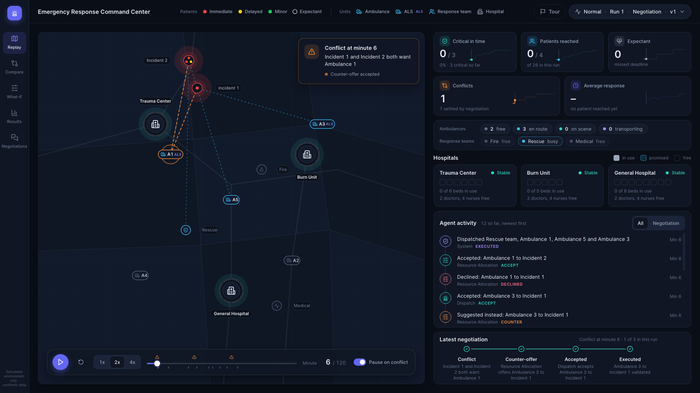
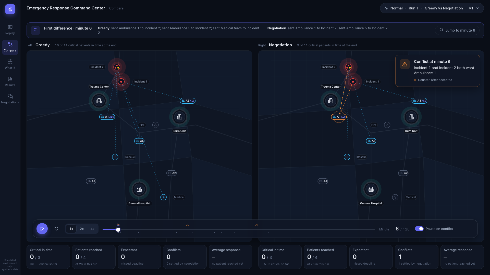
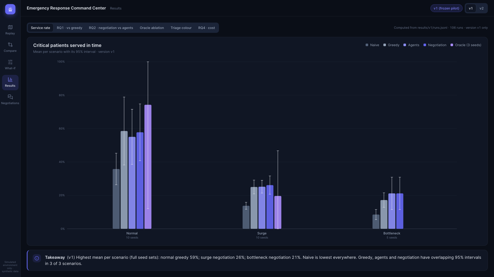
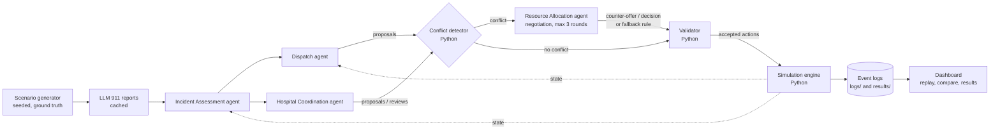

# Emergency Response Command Center

[](https://github.com/akshaygovindd/emergency-response-agents/actions/workflows/tests.yml)

**Negotiation-based multi-agent emergency resource coordination**: when ambulances, responder teams and
hospital beds are contested, do autonomous LLM agents that communicate and negotiate outperform strong rule-based allocation?
Built for CSYE7380 (midterm, Prof. Das) with the OpenAI Agents SDK, a deterministic Python simulation, and a Streamlit replay dashboard.

**Live dashboard: [emergency-response-agents.streamlit.app](https://emergency-response-agents.streamlit.app/)** (replays saved runs; no API key needed).

> **Simulated environment only. Not for real emergency dispatch or medical decisions.** All data is synthetic.

The agents only *propose* actions. Python owns reality: it detects conflicts, validates every action against the
rules, executes it in a seeded 120-minute simulation of a 20 x 20 km city, and logs everything. We compare five systems
(naive, greedy, agents without negotiation, agents with negotiation, and an oracle ablation) on 3 scenarios
(normal, surge, bottleneck) with 5-10 seeds each. **Headline result:** the agent systems are far better than naive and
not statistically distinguishable from a strong greedy allocator (paired intervals up to ±20 points wide, so equivalence is not shown), and negotiation changes decisions in only 15 of 50 paired runs with a small, mixed effect.
The write-up is in [docs/RESULTS.md](docs/RESULTS.md).



| Compare: two systems on one clock | Results: RQ1-RQ4 with confidence intervals |
|:--|:--|
|  |  |

The dashboard replays saved runs from their event logs (no simulation, no API calls): pick version, scenario, run and system, press play,
and watch incidents appear, ambulances move, agent messages stream (proposal, conflict, counter-offer, accept, commit), hospitals fill and KPIs update.
Pages: Replay, Compare, What-if (re-runs naive and greedy live), Results, Negotiations.

## Research questions and results

Primary metric: **critical service rate (CSR)**, the share of critical victims (severity 4-5) first reached within their deadline. Mean over seeds;
95% confidence intervals and every number below are in [docs/RESULTS.md](docs/RESULTS.md) and `results/analysis/`.

| | scenario | naive | greedy | agents | negotiation |
|:--|:--|--:|--:|--:|--:|
| **v1** | normal (10 seeds) | 35.8% | 58.5% | 55.0% | 57.8% |
| | surge (10) | 13.8% | 25.0% | 25.2% | 26.2% |
| | bottleneck (5) | 8.5% | 17.2% | 21.2% | 21.2% |
| **v2** | normal (10) | 35.8% | 58.5% | 59.1% | 59.1% |
| | surge (10) | 13.8% | 25.0% | 25.8% | 24.7% |
| | bottleneck (5) | 8.5% | 17.2% | 20.1% | 20.1% |

* **RQ1, do agents beat strong rule-based allocation?** Not detectably. Every agent-minus-greedy interval contains zero (point estimates -3.5 to +4.0 points); agents and negotiation beat naive by +10.9 to +23.3 points, and all 12 of those intervals exclude zero (greedy beats naive by 8.7 to 22.7); the 4 bottleneck intervals rest on 5 seeds and are illustrative only.
* **RQ2, does negotiation help?** Not detectably. Negotiation minus agents is +2.7 / +1.0 points (v1 normal / surge) and 0.0 / -1.1 (v2), none significant. 35 of 50 paired runs never diverged; of 15 that did, negotiation helped in 4, hurt in 2, tied in 9.
* **RQ3, how does performance change as demand rises?** Every system falls steeply (greedy 58.5% to 25.0% to 17.2%). Ambulance conflicts per run fall (1.6 to 0.7 to 0.4 in v1) because no ambulance is free in 64%, then 85%, then 96% of the first 75 minutes (greedy), so there is less to negotiate exactly when pressure is highest. The ER was never full under greedy or the agent systems (naive filled one twice per version, in surge).
* **RQ4, what does it cost?** About $0.09 and 1.5-2 minutes of model time per agent run at list price (all 106 agent runs: $9.53, 9.86 M tokens), with no measurable gain over a free rule.

Limitations, stated plainly: small seed counts, no significant differences among agent systems and greedy, LLM-written reports from a formulaic generator, a synthetic grid, one model, one run per seed.

## Architecture



**The rule: agents propose, Python validates and executes.** No agent can change the world. Every proposal, counter-offer and revision is checked by one validator
(`sim/validator.py`) before it can be sent, and the engine checks again at execution. In all saved agent runs the validator blocked every invalid proposal
(209 in v1 and 334 in v2) and the engine had to reject nothing.

| Agent | Role |
|:--|:--|
| Incident Assessment | Reads the LLM-written 911 report and estimates each victim's severity and needed capability (baselines read ground truth; the oracle ablation gives agents ground truth too) |
| Dispatch | Proposes which ambulances and responder teams go where; in v2 also requests a destination hospital |
| Hospital Coordination | v1: proposes admissions. v2: reviews Dispatch's admission requests and accepts, rejects or counters (whole load, up to 3 rounds) |
| Resource Allocation | Arbitrates conflicts over the same ambulance or ER capacity: accepts one proposal, counter-offers another resource to the loser, up to 3 rounds, then a fixed fallback rule |

## Versions and how results are isolated

* **v1** (frozen pilot): Hospital Coordination proposes destinations; negotiation only over conflicts. Tags `calibration-frozen`, `environment-frozen`, `agents-frozen`.
* **v2** (tag `v2-frozen`): hospital admission negotiation added (Dispatch requests, hospital accepts / rejects / counters). Same agents otherwise; design in [docs/V2_DESIGN.md](docs/V2_DESIGN.md).
* Dashboard tags: `dashboard-v1` (before the redesign) and `dashboard-v2` (final).
* Results and logs live in `results/<version>/` and `logs/<version>/`. v1 is write-protected in the runner, every v2 run must pass `--version v2`, tables carry a `version` column, and v1 and v2 are never pooled. Naive and greedy are identical in both (verified).

## Setup and reproduction

Python 3.12+.

```bash
git clone https://github.com/akshaygovindd/emergency-response-agents.git
cd emergency-response-agents
python3.12 -m venv .venv && source .venv/bin/activate
pip install -r requirements-dev.txt && pip install -e . --no-deps
```

**Run the tests** (no API key needed; 243 tests, all offline):

```bash
pytest -q
```

**Print saved results** (free):

```bash
python scripts/run.py                    # v1
python scripts/run.py --version v2
python scripts/trace.py logs/v1/negotiation/normal_seed42_negotiation.jsonl   # readable run log
```

**Launch the dashboard** (replays saved runs; no API key, no simulation):

```bash
streamlit run dashboard/app.py
```

**Regenerate the analysis** (reads `results/` and `logs/` only; writes `results/analysis/`):

```bash
python scripts/analysis.py
```

**Run agent experiments** (uses OpenAI tokens, needs a key). Put `OPENAI_API_KEY=...` in a `.env` file at the repo root (git-ignored; never commit it), then for example:

```bash
python scripts/run.py --mode negotiation --scenario normal --seed 42 --version v2
```

All LLM calls are cached in `data/llm_cache/` (committed), so a rerun with the same inputs hits the cache, makes no API calls and is meant to reproduce the saved decisions
(see [docs/ASSUMPTIONS.md](docs/ASSUMPTIONS.md) section 14). A rerun rewrites that run's log and result row, so do it on a branch. v1 refuses writes without `--allow-v1-write`.
Running a new seed or changing a prompt calls the API.

## Project structure

```text
src/erc/
  config.py          every setting (agent model gpt-5.4-mini)
  models/            entities, messages, state (Pydantic)
  scenarios/         seeded generator; cached LLM 911 reports
  sim/               engine, validator, travel, deterioration
  policies/          naive and greedy baselines
  agents/            assessment, dispatch, hospital, negotiation, admission, conflicts, tools, prompts, LLM cache
  eval/              metrics, statistics, experiment runner
  dashboard/         data layer for the dashboard (export, story, compare, what-if, results)
dashboard/           Streamlit entry (app.py), thin pages (views/), HTML/JS apps and shared design system (ui/)
scripts/             run.py (experiments), trace.py (run log), analysis.py (final analysis)
data/                scenarios/, descriptions/, llm_cache/ (committed)
logs/<version>/      event log per run;  results/<version>/ metrics and tables;  results/analysis/ final tables and figures
docs/                RESULTS.md, ASSUMPTIONS.md, V2_DESIGN.md, DEPLOY.md, EXPERIMENT_LOG.md, design/
tests/               243 tests (simulation, validator, agents with fake LLM answers, dashboard data, analysis)
```

Further reading: [docs/RESULTS.md](docs/RESULTS.md) (findings and limitations), [docs/ASSUMPTIONS.md](docs/ASSUMPTIONS.md) (every simulation assumption),
[docs/DEPLOY.md](docs/DEPLOY.md) (Streamlit Community Cloud), [docs/design/DESIGN_SYSTEM.md](docs/design/DESIGN_SYSTEM.md).

## Testing

`pytest -q` runs 243 tests with no network access: physics and validator rules, scenario determinism, agent plumbing with fake LLM answers, conflict detection and negotiation,
metrics and statistics, dashboard data (replay export, compare, what-if, results), and the analysis script (which checks that per-victim outcomes rebuilt from the logs
match the saved metrics for all 206 runs). GitHub Actions runs the suite on every push.

## AI acknowledgment

Claude and Claude Code (Anthropic) were used throughout this project for design, coding, the dashboard and the analysis, working under the project rules in `CLAUDE.md` and `PLAN.md`
and reviewed by the author. The agents inside the simulation run on OpenAI `gpt-5.4-mini` through the OpenAI Agents SDK. Data is synthetic, and the author is responsible for the content and for every claim, each of which traces to a number under `results/`.
